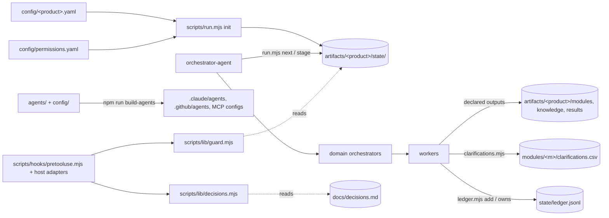

# Architecture

## Design principles

1. **Deterministic work lives in code, judgment lives in agents.** Run state, stage ordering, locks, output verification, the clarifications CSV, the created-entity ledger and permission checks are scripts with tests. Agents explore, reason and generate.
2. **One job per agent.** 34 small agents with declared inputs and outputs, in three layers: the main orchestrator → domain orchestrators → workers (native nested subagents). Workers never spawn and never talk to each other; every hand-off goes through the parent orchestrator as a file. Roster and flow: [`docs/agent-architecture.md`](docs/agent-architecture.md).
3. **Product-level knowledge.** Everything accumulates under `artifacts/<product>/` across runs (knowledge, module exploration, clarifications); per-run outcomes are archived under `results/<run-id>/`. One active run per product. Contract: [`docs/artifact-contract.md`](docs/artifact-contract.md).
4. **Permissions are data, enforced in code.** `config/permissions.yaml` is the ceiling for each agent; the run's `authorizations.mode` caps everyone (readonly ⇒ read-only for all). The guard identifies the calling agent and enforces spawns, shell, HTTP/load, browser and file writes. On a host that can't name the agent, it applies the run's combined ceiling instead. Deletes are limited to entities the current run created.
5. **Platform-neutral core, generated platform shells.** Each agent is written once (`agents/`); its Claude Code and GitHub Copilot files are generated from it and `config/` (tools from permissions, syntax from `config/platforms.yaml`). Every host runs the same hook entry through a thin adapter. Hosts: [`docs/platforms.md`](docs/platforms.md).
6. **Intentional design is recorded.** [`docs/decisions.md`](docs/decisions.md) says why each piece is the way it is; changing a file a decision governs needs the user's confirmation, enforced by the hook.

## Components

| Layer | Where | Responsibility |
|---|---|---|
| Agent sources | `agents/*.md` | the 34 roles in `docs/agent-architecture.md`, written once, platform-neutral |
| Platform build | `scripts/build-agents.mjs`, `scripts/lib/agents/`, `scripts/lib/mcp.mjs`, `config/platforms.yaml`, `config/mcp.yaml` | renders `.claude/agents/`, `.github/agents/`, `.mcp.json`, `.vscode/mcp.json`; `--check` gates drift |
| Domain scripts | `scripts/{knowledge,orchestration,results,report-data}.mjs`, `scripts/lib/testcases.mjs` | knowledge registry, loop bounds, normalized results, report numbers, test case checks |
| Contract + state | `scripts/lib/contract.mjs`, `scripts/run.mjs`, `schemas/` | layout, stage table, output verification, lock, history |
| Clarifications | `scripts/lib/clarifications.mjs`, `scripts/clarifications.mjs` | the product-level CSV: ids, de-dup, human-answer preservation; the module summary rendered from it |
| Safety | `scripts/lib/{guard,permissions,ledger,hosts,tool-call,browser-tools,guard-check}.mjs`, `scripts/ledger.mjs`, `scripts/hooks/` | mode cap, per-agent permissions, ledger-scoped deletes, host identity, liveness check |
| Governance | `docs/decisions.md`, `scripts/lib/decisions.mjs`, `scripts/roster.test.mjs` | decision log; confirmation before changing governed files; docs kept in step with the agent roster |
| Config | `config/run-config.example.yaml`, `config/permissions.yaml`, `config/models.yaml`, `scripts/run-config.mjs` | per-run settings, per-agent ceilings, per-agent models per platform |
| Generated test code | `playwright-tests/<product>/` (tests/ui + tests/api), `k6-tests/<product>/` | written by the Playwright/K6 domains |

## Status

- **Done:** foundation — layout v2, run lifecycle and lock, stage verification, clarifications CSV, ledger, permissions resolution and enforcement, run-config v2 (`npm test`).
- **Done:** knowledge domain — `knowledge-generator`, `scripts/knowledge.mjs`.
- **Done:** all other agents bottom-up to `orchestrator-agent`; `scripts/build-agents.mjs` (frontmatter from permissions + models), `orchestration.mjs`, `results.mjs`, `report-data.mjs`; stage attempts and blocked-dependency handling in `run.mjs`.
- **Done:** GitHub Copilot support from the same sources (VS Code Copilot Chat, Copilot CLI, cloud coding agent), one hook entry for every host, the decision log and its confirmation hook, CI running `npm run check`.
- **Next:** verify the Copilot runtime facts listed in `docs/platforms.md` on live sessions, a first end-to-end run against a real product, per-role models in `config/models.yaml`.
