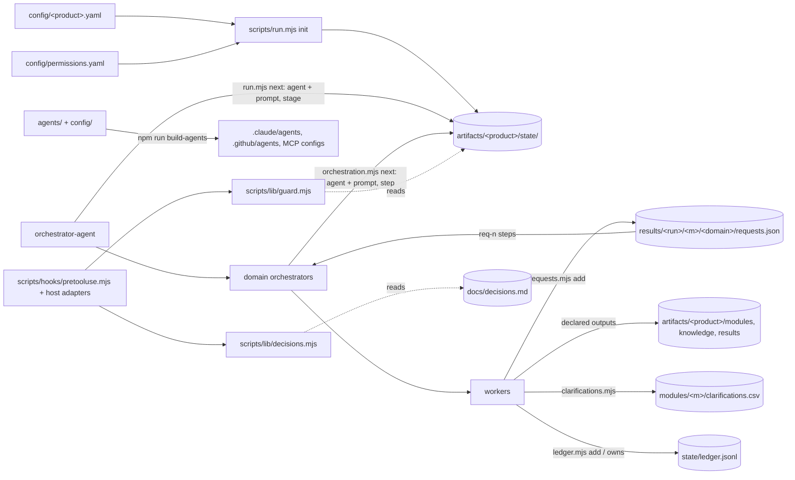

# Architecture

## Design principles

1. **Deterministic work lives in code, judgment lives in agents.** Run state, stage ordering, locks, output verification, the clarifications CSV, the created-entity ledger and permission checks are scripts with tests. Agents explore, reason and generate.
2. **One job per agent.** 34 small agents with declared inputs and outputs, in three layers: the main orchestrator → domain orchestrators → workers (native nested subagents). Workers never spawn and never talk to each other; every hand-off goes through the parent orchestrator as a file. Roster and flow: [`docs/agent-architecture.md`](docs/agent-architecture.md).
3. **Product-level knowledge.** Everything accumulates under `artifacts/<product>/` across runs (knowledge, module exploration, clarifications); per-run outcomes are archived under `results/<run-id>/`. One active run per product. Contract: [`docs/artifact-contract.md`](docs/artifact-contract.md).
4. **Permissions are data, enforced in code.** `config/permissions.yaml` is the ceiling for each agent; the run's `authorizations.mode` caps everyone (readonly ⇒ read-only for all). The guard identifies the calling agent and enforces spawns, shell, HTTP/load, browser and file writes. On a host that can't name the agent, it applies the run's combined ceiling instead. Deletes are limited to entities the current run created.
5. **Platform-neutral core, generated platform shells.** Each agent is written once (`agents/`); its Claude Code and GitHub Copilot files are generated from it and `config/` (tools from permissions, syntax from `config/platforms.yaml`). Every host runs the same hook entry through a thin adapter. Hosts: [`docs/platforms.md`](docs/platforms.md).
6. **Intentional design is recorded.** [`docs/decisions.md`](docs/decisions.md) says why each piece is the way it is; changing a file a decision governs needs the user's confirmation, enforced by the hook.

## Components

| Layer | Where | Responsibility |
|---|---|---|
| Agent sources | `agents/*.md` | the 34 roles in `docs/agent-architecture.md`, written once, platform-neutral |
| Platform build | `scripts/build-agents.mjs`, `scripts/lib/agents/`, `scripts/lib/mcp.mjs`, `config/platforms.yaml`, `config/mcp.yaml` | renders `.claude/agents/`, `.github/agents/`, `.mcp.json`, `.vscode/mcp.json`; `--check` gates drift |
| Domain scripts | `scripts/{knowledge,orchestration,results,report-data,report,gate,ui-code,api-code}.mjs`, `scripts/lib/report.mjs`, `templates/report/`, `scripts/lib/testcases.mjs`, `scripts/lib/ui-code.mjs`, `scripts/lib/api-code.mjs`, `scripts/lib/ts-scan.mjs`, `scripts/lib/agent-scope.mjs`, `scripts/lib/gate/`, `scripts/lib/domain-flows.mjs` | knowledge registry, each domain's flow and its next step (`orchestration.mjs next`), loop bounds, normalized results, report numbers, test case checks, the UI code scaffold and its locator checks, the generated API code and its checks, the pre-review gate |
| Roots + config | `scripts/lib/roots.mjs`, `scripts/lib/config.mjs` | the framework root (scripts, agents, default config, templates, schemas) and the workspace root (run-configs, `artifacts/`, test code, generated host files), one directory in this repo (D-085); `{fw}` in agent sources and permissions; the one reader of the framework's config files |
| Contract + state | `scripts/lib/contract.mjs`, `scripts/run.mjs`, `scripts/lib/files.mjs`, `schemas/` | layout, stage table, output verification, lock, history; atomic, locked state writes (D-072) and resume after a crash (D-071) |
| Clarifications | `scripts/lib/clarifications.mjs`, `scripts/clarifications.mjs` | the product-level CSV: ids, de-dup, human-answer preservation; the module summary rendered from it |
| Safety | `scripts/lib/{guard,permissions,ledger,hosts,tool-call,browser-tools,guard-check}.mjs`, `scripts/ledger.mjs`, `scripts/hooks/` | mode cap, per-agent permissions, ledger-scoped deletes, host identity, liveness check |
| Governance | `docs/decisions.md`, `scripts/lib/decisions.mjs`, `scripts/roster.test.mjs` | decision log; confirmation before changing governed files; docs kept in step with the agent roster |
| Config | `config/run-config.example.yaml`, `config/permissions.yaml`, `config/models.yaml`, `scripts/run-config.mjs` | per-run settings, per-agent ceilings, per-agent models per platform |
| Generated test code | `playwright-tests/<product>/` (tests/ui + tests/api), `k6-tests/<product>/` | written by the Playwright/K6 domains |

## Status

- **Done:** foundation — layout v2, run lifecycle and lock, stage verification, clarifications CSV, ledger, permissions resolution and enforcement, run-config v2 (`npm test`).
- **Done:** knowledge domain — `knowledge-generator`, `scripts/knowledge.mjs`.
- **Done:** all other agents bottom-up to `orchestrator-agent`; `scripts/build-agents.mjs` (frontmatter from permissions + models), `orchestration.mjs`, `results.mjs`, `report-data.mjs`; stage attempts and blocked-dependency handling in `run.mjs`.
- **Done:** GitHub Copilot support from the same sources (VS Code Copilot Chat, Copilot CLI, cloud coding agent), one hook entry for every host, the decision log and its confirmation hook, CI running `npm run check`.
- **Done:** end-to-end harnesses (D-084): `scripts/pipeline.test.mjs` drives `run.mjs next` from init to a verified report with stand-in agents on every `npm test`; `make e2e` runs the rendered foundation against a local demo app in a real browser, readonly and full-run, then the human's ledger sweep.
- **Next:** verify the Copilot runtime facts listed in `docs/platforms.md` on live sessions, a first agent-driven run against a real product, per-role models in `config/models.yaml`.

## Control flow (D-060)

A run executes only the steps the human chose (D-066: explore, clarifications, testcases, playwright-ui, playwright-api, k6), plus the stages they need (knowledge, the `api-discovery` endpoint catalogue, the Playwright repo, the report); every other stage is "not chosen", never failed. Before the first stage, `run.mjs prereqs` lists each module's missing prerequisites, and the orchestrator asks the human how to fill each one: explore, ask clarifications, generate test cases, describe scenarios for the explorer, import their own test case file, or skip the step. k6 loads only the approved `@performance` cases and no longer waits for the API tests (D-068).

Both orchestrator levels are pure loops over a script's decision. `orchestrator-agent` repeats `run.mjs next`, which returns the stages to start with the agent and the exact prompt of each (run id, mode, test case format and module come from the run state; reusable knowledge is marked done by the script); it starts each agent, then calls `stage ... done`, which on a refusal returns one `retry` (agent and prompt) and fails the stage on the second. A domain orchestrator (one shared body, `agents/_shared/domain-loop.md`) repeats `orchestration.mjs next`: it starts the agent with its prompt and marks the step. A worker that needs a shared-file change, a missing method or export or a foundation gap records it with `requests.mjs add`; `next` turns each request into a handler step with a once-limit kept in state, takes the pw-repo-owner lock so the UI and API domains never use it together, and re-runs the worker that asked. A review that fails its rounds fails the stage and blocks its dependants. When only stages waiting for a human's test case sign-off are left, `run.mjs next` offers the report, then `end` says `awaiting-approval` with the sheets to review; the next run continues from what that run completed (`carriedFrom`).
